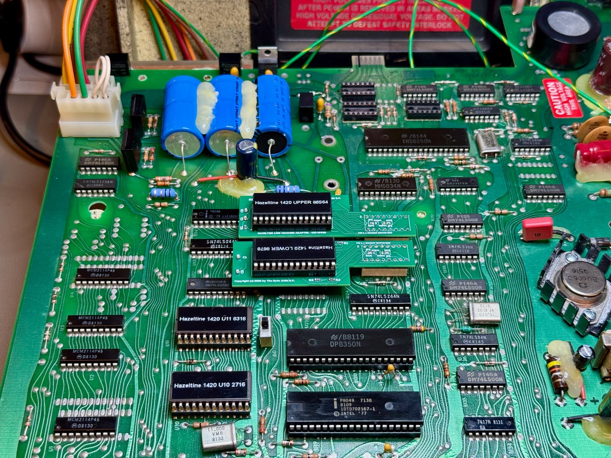
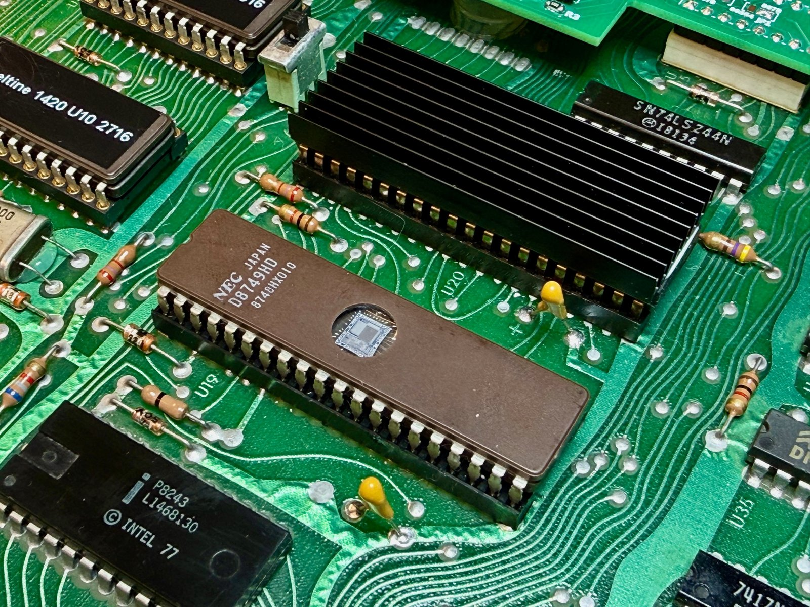

# Hazeltine 1420 firmware (from bitsavers.org)

Copies of the firmware and documentation of the Hazeltine 1420 as preserved on
[bitsavers.org](http://www.bitsavers.org/pdf/hazeltine/Hazeltine_1420/), kept here so that the
character-generator adapters and the firmware needed to run them are in one place.

| File | What it is |
|------|-----------|
| `hazeltine_1420_firmware/hazeltine_1420_u10_2716.hex` | **Intel HEX**, 2 KB, addresses 0x000-0x7FF: contents of U10, a 2716 EPROM |
| `hazeltine_1420_firmware/hazeltine_1420_u11_8316.hex` | **raw binary** despite the extension, 2 KB, addresses 0x800-0xFFF: contents of U11, an 8316 mask ROM |
| `hazeltine_1420_firmware/hazeltine_1420_u19_8049h.hex` | **raw binary**, 2 KB: the internal ROM of the 8049 CPU, U19 (Hazeltine mask 1DTD702167-1) |
| `HI-1079_Hazeltine_1420_Reference_Manual_Jul79.pdf` | the reference manual: installation, controls and switches, remote commands, the EIA/current-loop interface, servicing |
| `h1420_descr.jpg`, `pcb1.jpg`, `pcb2.jpg`, `pcb3.jpg` | bitsavers' photos and description of the unit the images came from |

## How the terminal uses them

The CPU is an Intel 8049 whose EA pin (pin 7) is tied to +5 V on the board, so its internal ROM is
never executed; all code is fetched from the external ROMs: U10 holds 0x000-0x7FF and U11 holds
0x800-0xFFF. The 8049 image is therefore not needed to run the terminal; it is the same program that
the board's U10 contains in a revised form, and it is useful for making a self-contained spare CPU.

## Putting it back into a terminal

* **U10 and U11**: program each image into a 2716 EPROM (U10 from the Intel HEX file, U11 from the raw
  file). Pin 21 of both sockets carries +5 V on the board, so a 2716 works in the U11 socket in place
  of the original 8316 mask ROM; a 2732 also works if the image is placed in both halves.
  Keep U10 and U11 as a matched pair: they belong to the same firmware revision.
* **U19**: any 8049, 8039 or 8749 runs, because the internal ROM is unused. An 8749 programmed with
  `hazeltine_1420_u19_8049h.hex` is a spare that would also work in a board where EA is low.
  Cover its window.

*The original Intel P8049 (mask 1DTD702167-1, date code 8109) in U19, with U10 and U11 to its left,
already replaced by 2716 EPROMs carrying these images.*

*A NEC uPD8749HD (the EPROM version of the 8049), programmed with the 8049 image, installed in U19.*

## Notes

* The terminal in this repository shipped with a U11 (8316) whose contents differ from the bitsavers
  image in 1829 of 2048 bytes: a later firmware revision, which also carries fragments of 8048 assembly
  source text in its unused tail. It is not included here; the bitsavers pair is what runs the
  terminal now.
* The serial format of the 1420 is fixed: 1 start bit, 7 data bits, parity (ODD/EVEN/1/0 by switch),
  2 stop bits transmitted; see section 5 of the manual.
