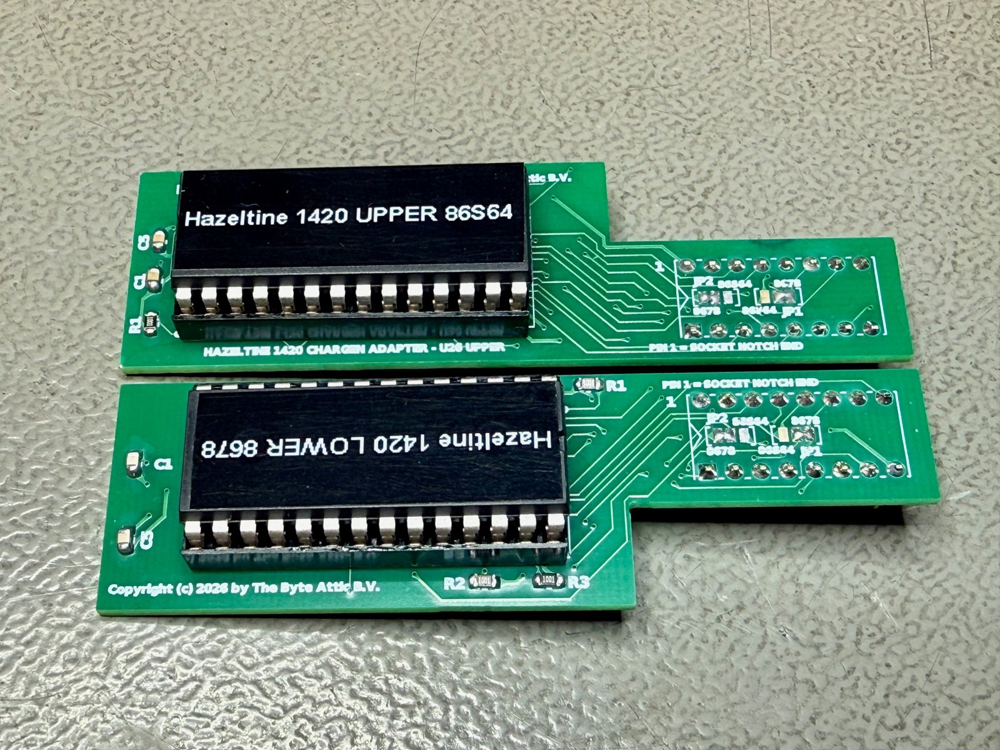
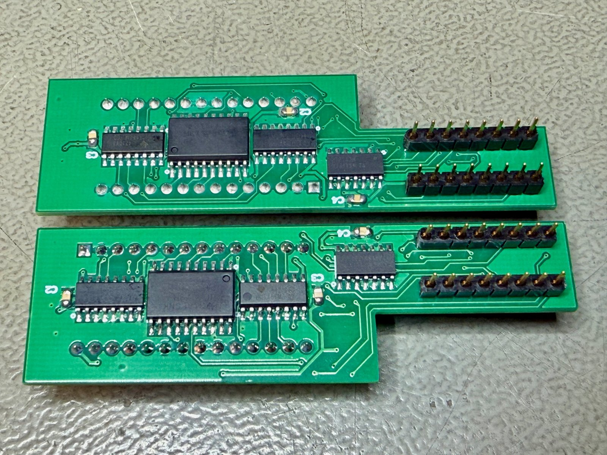
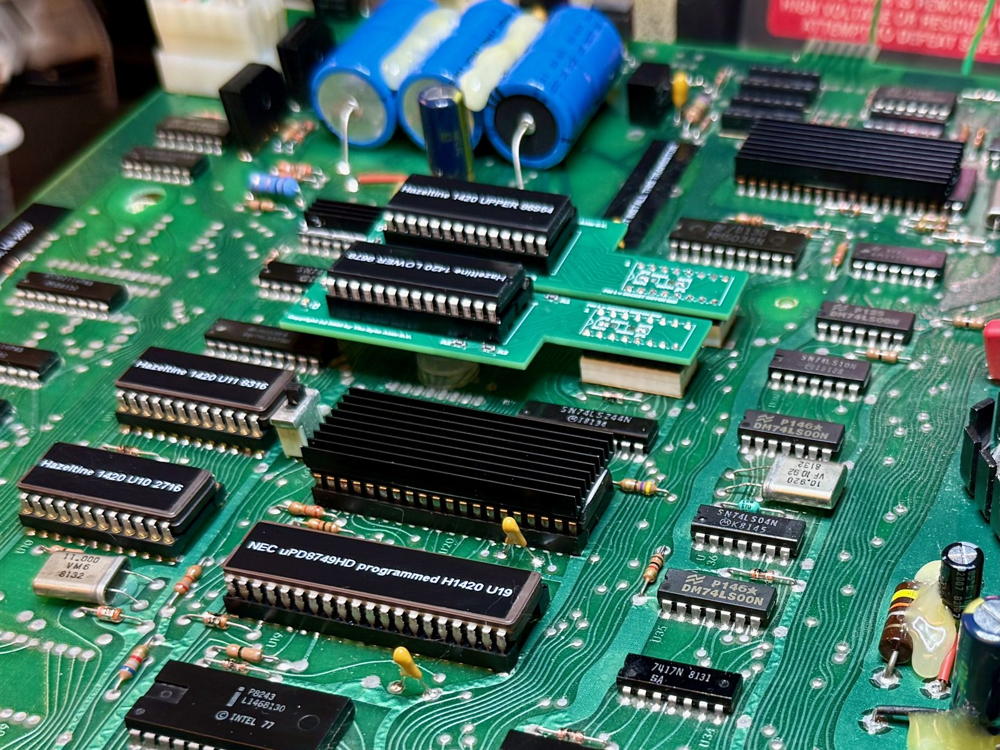

# Hazeltine 1420 character-generator adapter

Replacement for the two National Semiconductor character-generator ROMs of the Hazeltine 1420
video terminal (DM8678 and DM86S64 at sockets U25 / U26), built from parts that are still made.

Copyright (c) 2026 by The Byte Attic B.V.

*The two adapters, EEPROM side. These are revision A boards (the small jumper pads near the plug);
revision B, in this repository, has that wiring in copper and no jumpers. Everything else is identical.*

## Why

The DM8678 and DM86S64 are 16-pin bipolar mask ROMs from the late 1970s that hold the font *and*
contain the scan-line counter and the dot shift register, so the terminal only sends them a
character code, a row clock and a dot clock and gets serial video back. When one of them fails
there is no replacement: the parts are unobtainable and their contents are custom to the terminal.

These adapters plug into the original sockets and rebuild the complete function from a
standard EEPROM plus four 74HCT logic chips, using a font dumped from the original chips while
they still work. The terminal does not know the difference.

## What is in this repository

| Directory | Contents |
|-----------|----------|
| [`hardware/`](hardware/) | Gerbers ready for JLCPCB, KiCad boards, schematic, bill of materials, renders |
| [`font/`](font/) | Arduino sketch that dumps the original chips, the dumps of one terminal, the EEPROM images and the script that builds them |
| [`source/`](source/) | The Python toolchain that designed, routed, exported and verified the boards |
| [`docs/`](docs/) | Verification report of the manufacturing files, and the DM8678 / DM86S64 data sheets |

## Quick start

1. **Dump the fonts first**, while the original chips are healthy: `font/README.md`. If your chips are
   already dead, the images in `font/` (from a 1979 Hazeltine 1420) are what you need.
2. **Order the boards**: upload `hardware/gerbers/h1420-chargen-U26-upper-gerbers.zip` and
   `hardware/gerbers/h1420-chargen-U25-lower-gerbers.zip` to JLCPCB as they are (2 layers, 1.6 mm).
3. **Order the parts**: `hardware/bom.csv` (one adapter; you need two of everything).
4. **Program two AT28C64B EEPROMs** with the two 8 KB images and verify them after a power cycle of
   the programmer.
5. **Assemble and install**: see below.

## The circuit in one paragraph

A 74HCT373 latches the 6-bit character code (and socket pin 12, the A7/enable line) when the
terminal strobes it on pin 4. A 74HCT161 counts the 16 scan lines of a character row from the
terminal's line clock, clock-control and clear signals, exactly like the counter inside the
original chip. The latched code and the row count address an AT28C64B EEPROM whose 1 KB image
holds 64 characters x 16 rows x 7 dots (the descender shifting the original did in hardware is
baked into the image row by row). A 74HCT166 shift register loads the 7-dot row on the terminal's
load pulse and shifts it out at the dot clock, and a 74HCT125 tri-state buffer drives that serial
video onto socket pin 11, enabled while the latched pin 12 is low. 74HCT (not 74HC) is required
because the terminal drives the socket with 74LS levels. The schematic is `hardware/schematic.pdf`.

| Ref | Part | Function |
|-----|------|----------|
| U1 | 74HCT373D (SOIC-20 wide) | transparent address latch (socket pin 4 = latch control), also latches pin 12 (A7 = enable) |
| U2 | 74HCT161D (SOIC-16) | mod-16 line counter: line clock, clock control, /clear exactly as the original |
| U3 | 74HCT166D (SOIC-16) | 7-bit parallel-in / serial-out shift register, synchronous load on /LOAD |
| U4 | 74HCT125D (SOIC-14) | tri-state video output buffer: output to socket pin 11, /OE from latched pin 12 |
| U5 | AT28C64B-15PU in DIP-28 socket | font EEPROM (27C64 / 27C256 / 27C512 also fit; the image is built for all of them) |
| R1-R3 | 1 k 0805 | pull-ups on EEPROM pins 1, 26, 27 (28C64 /WE high; 27C256/27C512 A13-A15 high) |
| C1-C5 | 100 nF 0805 | decoupling |
| P1 | 2 x 8 round machined pins | the plug into the original socket |

## Two board shapes, one circuit

The two sockets sit 17 mm apart, so each adapter bends away from the other:

    U26 (upper socket)  ->  board "U26-upper"  (body extends upward, away from U25)
    U25 (lower socket)  ->  board "U25-lower"  (body extends downward, away from U26)

Both carry the same circuit; only the outline and the layout differ. There are no jumpers and no
configuration: the two adapters are identical apart from the board shape and the EEPROM contents.

## Which font goes where

The DM8678 holds the control-symbol glyphs (codes 0x00-0x1F) and the lower-case half of ASCII;
the DM86S64 holds capitals, digits and punctuation. Put the EEPROM with the font of the chip that
was in U26 into the U26-upper adapter and the other into the U25-lower adapter. In the author's
terminal that is the DM86S64 in U26 and the DM8678 in U25, and the image files in `font/` are named
accordingly (`DM86S64CQSN-U26-upper.bin`, `DM8678CRCN-U25-lower.bin`). If capitals come out as
control symbols, the two EEPROMs are swapped.

## Assembly

*Bottom side: U1-U4 (SOIC) and the decoupling capacitors; the machined plug pins point down.*

* Bottom side first: U1-U4 (watch the pin-1 dots on the silkscreen; U1 is rotated 180 degrees
  relative to the others on purpose), then C1-C4. 1.27 mm SOIC, drag-solderable.
* Top side: the DIP-28 socket (notch as drawn), C5, R1-R3, then the two 8-pin round machined pin
  strips into the plug holes at the right-hand end, pins pointing **down**. Push the strips into a
  spare DIP socket while soldering so they end up straight. They must be round (turned) pins so
  they fit the original socket without damaging it.
* Insert the programmed EEPROM, notch towards the socket's notch marking.

## Installation

The plug goes in with its pin 1 (square pad, marked "1") at the socket's notch end, i.e. the left
end, bottom row. The board then lies over the socket and extends to the left. The neck is 14 mm
wide, so it overhangs the socket by about 1.6 mm on each side; the two adapters end up roughly
3 mm apart. The body rides about 10 mm above the logic board, clear of the soldered DIPs and the
empty pad field underneath.

## If the picture is wrong

* Every character of one set shows as a solid block: that EEPROM reads 0xFF - not programmed, or a
  pin not making contact; read it back in the programmer.
* Capitals shown as control symbols (or lower case as capitals): the two EEPROMs are in the wrong
  adapters; swap them.
* One character set blank: the enable polarity is wrong for that chip; fit a 74HCT126 (same
  pinout, active-high enable) for U4 on that adapter. Both chips of the author's terminal enable
  with pin 12 low, which is what the boards are wired for.
* Characters mirrored or garbled rows: the dump was captured with the wrong `CHIP` setting or the
  wrong chip; re-dump.
* Picture shifted by a dot or two: the EEPROM is slower than the original's 280 ns address-to-load
  window; use a 70 ns 28C64. With the -15 part the chain is about 190 ns, so this is not expected.

## Design notes

* Timing budget: latch 25 ns + EEPROM 150 ns + register set-up 15 ns = 190 ns against the 280 ns
  minimum address-to-load time of the original; dot clock up to 25 MHz with 74HCT166 (the 1420 runs
  10.92 MHz).
* Logic family: 74HCT throughout. The terminal drives the socket from 74LS outputs, whose
  guaranteed high level (2.7 V) is below the 3.5 V a plain 74HC input needs.
* Verification (see `docs/verification-report.txt`): connectivity is reconstructed from the
  Gerber copper and drill files alone and compared with the schematic netlist (identical, 126 pins in
  44 nets per board); that reconstructed netlist is then simulated structurally against a
  behavioural model of the DM8678 written from its datasheet (18 000 random cycles per board, zero
  mismatches, no bus contention); design-rule check against JLCPCB's 2-layer capabilities passes on
  both boards; an independent short/open/clearance checker reports zero problems.
* Revision history: rev A had two solder jumpers to choose between the DM8678 and the DM86S64 pin
  assignment. Both original chips were measured to behave identically (video out on pin 11, enable
  on pin 12, active low), and both rev A boards were built and run in that position. Rev B (this
  repository) is rev A with that position wired in copper and the jumpers removed, without
  re-routing anything else (`source/dejumper.py`). Rev A boards work unchanged with JP1 C-A and
  JP2 C-A bridged.

## Status

Built, installed and in daily use in a Hazeltine 1420 (rev A boards, jumpered as rev B is wired).
