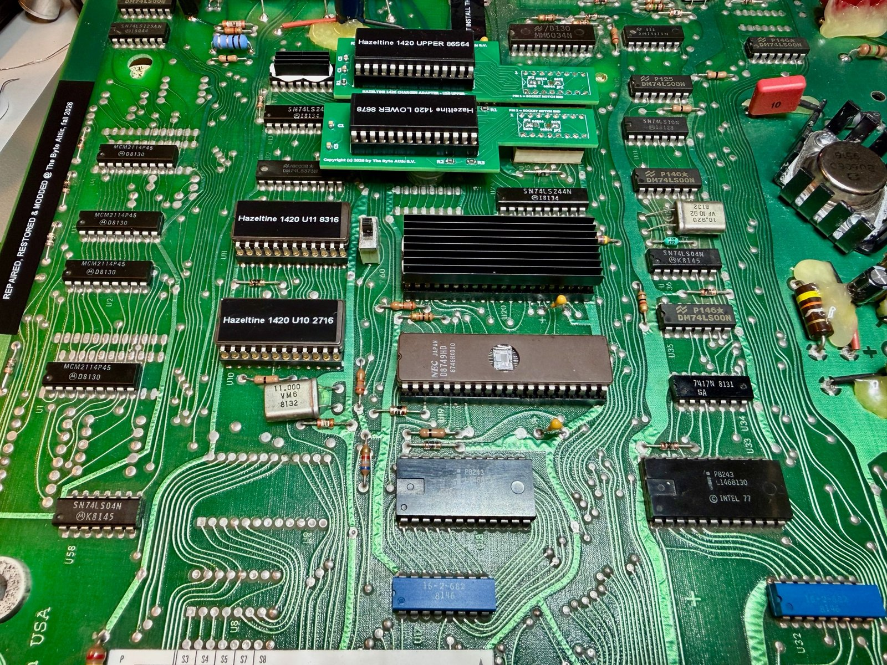

# Hazeltine 1420: character-generator adapters and firmware

Everything needed to keep the logic board of a Hazeltine 1420 video terminal (1979) alive when its
custom chips fail: plug-in replacements for the two proprietary character-generator ROMs, and copies
of the firmware for the CPU and its two program ROMs.

*The restored board. In the centre-left, the two green character-generator adapters sit in the
original U25/U26 sockets; below them the firmware ROMs U10 and U11, and the CPU U19.*

## Contents

| Directory | What it is |
|-----------|-----------|
| [`H1420-chargen-adapter/`](H1420-chargen-adapter/) | Two small boards that replace the National DM8678 and DM86S64 character generators with an EEPROM and four 74HCT chips: Gerbers, KiCad files, schematic, BOM, the fonts dumped from the original chips, the Arduino dumper, and the Python toolchain that designed and verified the boards |
| [`H1420-Bitsavers-firmware/`](H1420-Bitsavers-firmware/) | The terminal's firmware as preserved on bitsavers.org (images of U10, U11 and the 8049's internal ROM), the reference manual, and photos of the bitsavers unit |
| [`images/`](images/) | Photos of the boards and of the installation used in the READMEs |

## The chips this repository replaces

The 1420's logic board is built around an Intel 8049 microcontroller (U19) with two external program
ROMs, a 2716 EPROM (U10, addresses 0x000-0x7FF) and an 8316 mask ROM (U11, 0x800-0xFFF); the 8049's
own internal ROM is disabled (EA, pin 7, is tied high), so the CPU runs entirely from U10/U11. Display
timing comes from a National DP8350 CRT controller, and the characters themselves from two National
character generators, a DM8678 (control symbols and lower case) in U25 and a DM86S64 (capitals, digits,
punctuation) in U26.

Four of these parts are unobtainable today and three of them are custom to the terminal:

* **U10 and U11** can be rebuilt from the firmware images in `H1420-Bitsavers-firmware/`; both fit
  into ordinary 2716 EPROMs (pin 21 of both sockets is +5 V).
* **U19** can be any 8049, 8039 or 8749 since the internal ROM is not used; an 8749 programmed with the
  8049 image (also in the firmware folder) makes a self-contained spare.
* **U25 and U26** have no equivalent at all. The adapters in `H1420-chargen-adapter/` rebuild their
  function from current parts, using fonts dumped from the original chips.

*The two adapters in place: "UPPER 86S64" in U26, "LOWER 8678" in U25. The boards shown are revision A
with their jumpers bridged; revision B, in this repository, has that wiring in copper and no jumpers.*

## Quick start

1. Dead or dying character generator: read `H1420-chargen-adapter/README.md`. Dump your own chips
   first if they still work (`H1420-chargen-adapter/font/`); otherwise use the fonts there.
2. Dead firmware ROM or CPU: read `H1420-Bitsavers-firmware/README.md`.
3. Everything in here was built, installed and is running in the author's terminal.

## Credits

The firmware images, the reference manual and the photos of the bitsavers unit come from
[bitsavers.org](http://www.bitsavers.org/pdf/hazeltine/Hazeltine_1420/). The adapters, the font dumps
and the toolchain are by The Byte Attic B.V.

## Licence

MIT, see [`LICENSE`](LICENSE). The bitsavers material is redistributed as found there.
